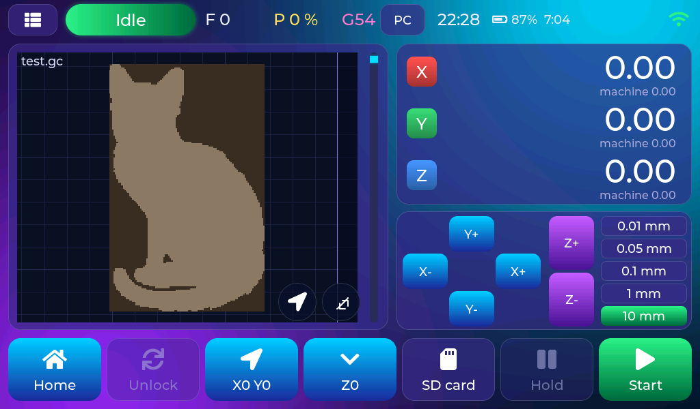
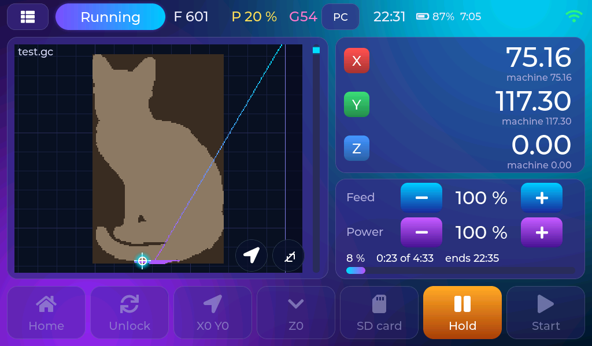
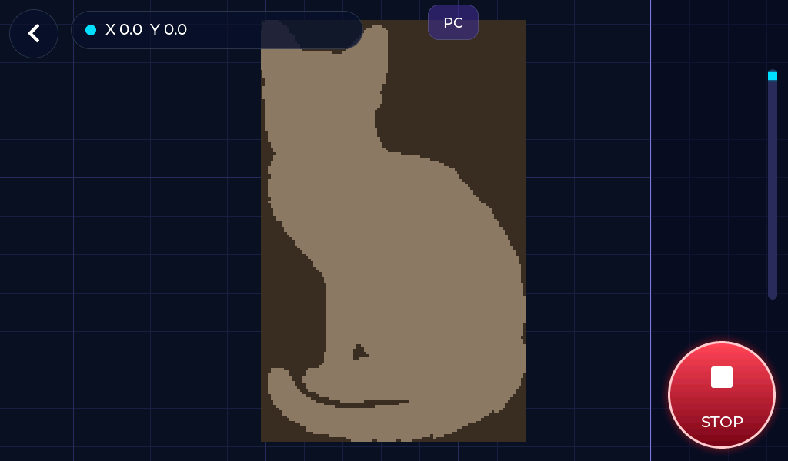
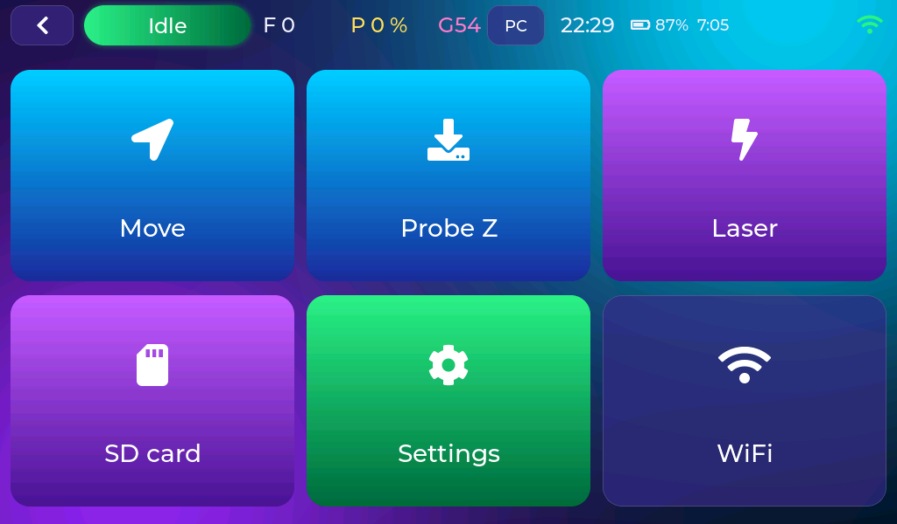
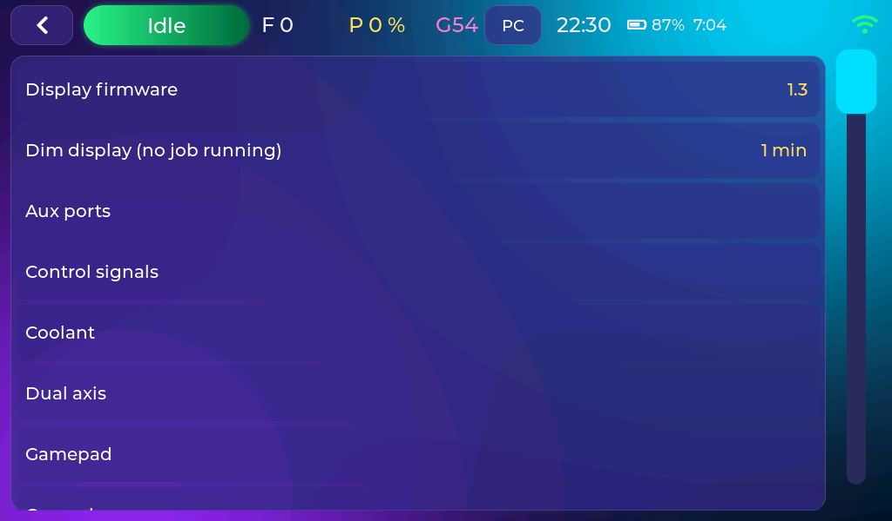

# grblHAL-Plugin-Display

A touch display for a [grblHAL](https://github.com/grblHAL) CNC or laser machine, in two variants:

- **ESP32-S3 + MKS TS35** (3.5", 480x320, ST7796 + XPT2046 resistive touch), talks to the grblHAL board over a UART.
- **Elecrow CrowPanel Advanced 9" ESP32-P4** (1024x600, capacitive touch), connected over USB or WiFi through a
  small ESP32-S3 bridge at the controller, see [CrowPanel 9" ESP32-P4](#crowpanel-9-esp32-p4).

The display shows the machine state, the position and a map of the machine area with the live tool path and a
**preview of the G-code file** to be run from the SD card. It starts and stops jobs, jogs, probes Z, fires laser
test pulses and edits the grblHAL settings.

Developed for a BTT Octopus Pro v1.0 (STM32F446), see
[Steppge/grblHAL-OctopusPro-CNC-Laser](https://github.com/Steppge/grblHAL-OctopusPro-CNC-Laser).
The plugin only uses grblHAL core APIs and is not tied to a driver or MCU.

> **Prototype.** Keep a hand on the power or emergency stop switch when trying it on your machine.
> The STOP button on the display is a software stop, it does not replace an emergency stop.

## Contents

| File | |
|---|---|
| [`display_link.c`](display_link.c) | grblHAL plugin (`DISPLAY_LINK_ENABLE`): status to the display, commands from it |
| [`my_plugin.c.example`](my_plugin.c.example) | Starts the plugin from `my_plugin_init()` |
| [`esp32s3/`](esp32s3/) | ESP32-S3 firmware (PlatformIO, Arduino, LovyanGFX, LVGL 9) |
| [`esp32s3/web/`](esp32s3/web/) | Web interface (one HTML page, embedded into the firmware) |
| [`esp32p4/`](esp32p4/) | ESP32-P4 firmware for the CrowPanel 9" (PlatformIO, Arduino, LVGL 9) |
| [`esp32p4/case/`](esp32p4/case/) | Housing for the CrowPanel 9" (STEP and STL) |
| [`esp32common/`](esp32common/) | Code shared by both firmwares: link, WiFi, web interface, map |

## Screens

- **Main**: state (with alarm names such as `HARD LIM`, `NO HOME`), feed, power/speed, work offset, link state;
  map card and X/Y/Z card; six buttons that change between idle and job:
  - idle: Home (hold), Unlock / Reset / Hold 3s, X0 Y0 (hold), Z0 (hold), Hold, Load / Start (hold)
  - job: Feed -/+ and Power -/+ (tap ±10 %, hold 100 %), Hold / Stop (hold), Resume
- **Map**: a Z height bar on the right (tool in cyan, work zero in yellow); the machine area with a frame, the live trace of the tool while the laser/spindle is on, the tool
  crosshair and the G54 origin. After a file has been loaded it switches to the **G-code preview** (to do: beige,
  done: colored). The button next to the zoom button toggles between preview and machine area.
- **Zoom**: the map full screen with two buttons, back and STOP. First tap on STOP: feed hold, the laser/spindle
  is switched off once the machine stands; the button then becomes ABORT (reset).
- **Menu**: Move (jog X/Y/Z, steps 0.01-10 mm), Probe Z (plate thickness, feed), Laser (test pulse power and
  time), SD card (file list, Load), Settings (groups, list, edit with keypad, gamepad buttons), WiFi.
- Errors of commands and SD jobs appear in a banner. After an SD job has stopped with an error grblHAL refuses
  jogs until a reset, the main screen then offers Reset.
- Beeper: click on button presses, three beeps on an alarm or error, two when a job of at least 10 s has finished.

## Installation (PlatformIO)

1. Add this repository to your grblHAL driver, next to the other plugins:
   ```
   git submodule add https://github.com/Steppge/grblHAL-Plugin-Display display
   ```
2. `platformio.ini`, in your environment: add `display` to `lib_deps` and `-D ADD_MY_PLUGIN=1` to `build_flags`.
3. Copy `my_plugin.c.example` to `Src/my_plugin.c` (or add its call to your existing `my_plugin_init()`).
4. `Inc/my_machine.h`:
   ```c
   #define DISPLAY_LINK_ENABLE     1 // ESP32-S3 touch display
   //#define DISPLAY_LINK_STREAM   1 // serial stream instance of the UART the ESP32-S3 is connected to
   //#define DISPLAY_LINK_BAUD 115200
   ```
5. Build and flash the ESP32-S3 firmware: open `esp32s3/` in PlatformIO, environment `display`.
   `esp32s3/platformio.ini` uses the pioarduino platform (Arduino 3.3, ESP-IDF 5.5) for an ESP32-S3-DevKitC-1
   N16R8 (16 MB flash, 8 MB octal PSRAM), the PSRAM is needed.

For CMake based builds use the included `CMakeLists.txt` (library `display`).

### Firmware updates over WiFi

Once flashed over USB, the ESP32-S3 can be updated over WiFi:

1. Menu - WiFi: the display scans for networks, pick yours, type the WiFi password, an OTA password and a machine
   name, Save, then switch WiFi On. The status line shows the IP address and `<name>.local`
   (default `grblhal-display.local`).
2. PlatformIO: environment `ota`, Upload. The OTA password is read from the environment variable
   `GRBLHAL_DISPLAY_OTA` (Windows: `setx GRBLHAL_DISPLAY_OTA "..."`, then restart VS Code). The ESP32-S3
   connects back to the PC for the data, allow Python in the firewall (Windows asks on the first upload).
3. Or in a browser: `http://grblhal-display.local/update`, user `admin`, the OTA password, choose `firmware.bin`.
4. Or in the web interface (logged in for control): tab Update, choose `firmware.bin`, hold Update. The page shows
   the upload, the display the writing; afterwards the tab shows the ID of the running firmware, which changes
   with every build.

### LightBurn (or another sender) over WiFi

The display passes a TCP connection on port 23 through to the second UART (921600 baud). While a sender is
connected that UART is the active grblHAL stream, as with telnet on boards with networking; USB does not take
commands then. In LightBurn: device type GRBL, connection Ethernet/TCP, address `<name>.local` (or the IP
address), port 23. While a sender is connected the WiFi symbol in the status bar is shown on a cyan badge.

If the connection is lost while a job runs, the plugin holds the job and switches the laser/spindle off once
the machine stands; resume or abort on the display. Raster jobs with many short lines may stutter over WiFi,
large raster jobs are better run from the SD card.

The machine name (WiFi screen, field Name) is the mDNS name (`<name>.local`) and the DHCP host name. Without
`.local` it works when the router resolves the names of its clients.

### Web interface

Any browser on the same network (phone, tablet, PC) can show and control the machine at `http://<name>.local`
(or the IP address): status, position, the map with the G-code preview and the live trace, the main buttons
(Home, Unlock, X0 Y0, Z0, Hold/Stop, Start, Feed and Power overrides), a fullscreen map with STOP, jogging and the
SD card. Commands go through the same queue and follow the same rules as the buttons on the display (holding
for Home, zero and Start, STOP first holds and switches the laser off, then aborts). The display and browsers
work at the same time.

The button Web on the WiFi screen switches between Off, View (default, anyone on the network can watch) and
Control. To control, the browser asks once for the OTA password; the device remembers it until the password
changes. The page is `esp32s3/web/index.html`, it is gzipped into the firmware at build time.

Updates are only accepted while the machine is idle, in alarm or not connected, the display shows the progress.
Without an OTA password no update is accepted. If an update fails the previous firmware keeps running.

`DISPLAY_LINK_STREAM` is the instance number of a serial stream of your driver. On the BTT Octopus Pro with the
main connection on USB: 0 = USART1 (TFT header), 1 = USART2 (PD5 TX2 / PD6 RX2 header next to the USB-C
socket), 2 = USART3 (WIFI socket). The port must not be used by anything else.

## Wiring

The TS35 is connected with its two EXP ribbon cables. Wire numbers count from the marked wire 1 of the cable
(red stripe) and assume the cables are plugged into the TS35 with the key, as they come.

| Cable | Wire | TS35 signal | ESP32-S3 |
|---|---|---|---|
| EXP1 | 1 | 5 V | 5Vin |
| EXP1 | 2 | GND | GND |
| EXP1 | 3 | LCD DC | GPIO9 |
| EXP1 | 4 | LCD CS | GPIO10 |
| EXP1 | 5 | Touch INT | GPIO18 |
| EXP1 | 6 | Touch CS | GPIO8 |
| EXP1 | 7 | LCD reset | GPIO14 |
| EXP1 | 8 | Backlight | GPIO21 |
| EXP1 | 10 | Beeper | GPIO7 |
| EXP2 | 2 | GND | GND |
| EXP2 | 5 | SPI MOSI | GPIO11 |
| EXP2 | 9 | SPI SCK | GPIO12 |
| EXP2 | 10 | SPI MISO | GPIO13 |

All other wires stay open. EXP2 wire 1 carries the 3.3 V of the TS35 (useful to check its supply), EXP2 wire 3
is the reset button of the TS35 (to GND), do not connect it to a supply.

| grblHAL board UART | ESP32-S3 |
|---|---|
| TX | GPIO16 (RX) |
| RX | GPIO17 (TX) |
| GND | GND |

For a sender over WiFi (below) a second UART, on the Octopus the WIFI socket (USART3):

| grblHAL board UART 2 | ESP32-S3 |
|---|---|
| TX (Octopus PD8, WIFI socket pin 15) | GPIO2 (RX) |
| RX (Octopus PD9, WIFI socket pin 16) | GPIO1 (TX) |

Supply: 5 V from the controller board (e.g. EXP1 5V/GND of the Octopus) to 5Vin of the ESP32-S3 and to EXP1 wire 1.

### Lessons from the bring-up

- **5Vin of the ESP32-S3 DevKitC-1 clones is an input only** while the `IN-OUT` solder bridge is open: with USB
  power the TS35 then gets no supply, it is only fed through the signal pins. Touch may still work, the display
  stays dark. Either close the bridge for USB tests or supply 5 V from outside. With the bridge closed never
  connect the 5 V of the controller and USB at the same time.
- Check the supply first: EXP2 wire 1 must show 3.3 V against GND.
- The MKS TS35 V2.0 can route LCD CS and DC to EXP1 or EXP2 (solder bridges JP1-JP4), the table above is the
  default (EXP1). On the V2.0_002 board the LCD data output is not connected, reading the panel ID returns FFFFFFFF.
- LVGL renders RGB565 little endian, the flush must hand it to LovyanGFX as `lgfx::rgb565_t`, otherwise colors
  are wrong and gradients show rings.
- With the beeper on GPIO15 the USB connection of the ESP32-S3 board dropped out now and then, on GPIO7 it is stable.
- Map orientation: `MAP_X_LEFT` and `MAP_Y_DOWN` in `esp32s3/src/map.cpp` (defaults for a machine with +X to
  the left and +Y to the front, seen from the front).

## CrowPanel 9" ESP32-P4

The same functions on a 9" screen with more room: larger map, X/Y/Z, job line with elapsed time and job end,
settings and SD card lists, firmware update from the display.

| | |
|---|---|
|  |  |
| Main screen, G-code preview of the loaded file | Job running: live trace, feed/power overrides, elapsed time and job end |
|  |  |
| Map full screen with STOP | Menu |
|  | |
| Settings: display options and the grblHAL setting groups | |

The images come from the display itself: the console command `shot` sends the screen to the PC,
`esp32p4/tools/shot.py <port> <file.png>` saves it (needs pyserial and Pillow, about 25 s per image).

### Parts

| Part | |
|---|---|
| Elecrow CrowPanel Advanced 9" ESP32-P4 (board V1.2) | the display; WiFi through its ESP32-C6 |
| ESP32-S3-DevKitC-1 N16R8 | the bridge at the controller (USB host and WiFi access point) |
| optional: EC11 rotary encoder | feed override |
| optional: battery board (e.g. IP5306 power bank board) + 18650 cells | cordless use over WiFi |
| optional: D1 Mini ESP32 with the [gamepad receiver](https://github.com/Steppge/grblHAL-Plugin-Gamepad) | PS4 controller for jogging |

Only for **ESP32-P4 chip revision v1.x** (the boards sold so far): the PlatformIO board `esp32-p4-evboard` uses
the framework libraries for revisions below 3.0.

### Connection to the controller

```
P4 display ==USB cable or WiFi==> ESP32-S3 bridge -UART-> grblHAL board (display link)
                                                   -UART-> grblHAL board (gamepad, optional)
```

The display's USB-C socket "USB 2.0" goes to the "USB" socket of the bridge. Without the cable the display
connects to a hidden WiFi network of the bridge; the network name and password are passed over the cable on
every plug-in, nobody types them. Bridge firmware and wiring:
[Steppge/grblHAL-Octopus-Bridge](https://github.com/Steppge/grblHAL-Octopus-Bridge) (ESP-IDF).
In `my_machine.h`: `DISPLAY_LINK_BAUD 921600` and, with the gamepad, `GAMEPAD_BAUD 230400`.

### Settings: `esp32p4/src/display_config.h`

Like Marlin's `Configuration.h`. Better than editing it: put your values into `esp32p4/src/my_display_config.h`,
which is read first and ignored by git, so they survive an update.

| Setting | Default | |
|---|---|---|
| `CLOCK` | 1 | time in the status bar and on the dimmed screen, job end as a time of day (NTP over the home network) |
| `ENCODER` | 1 | EC11 encoder on J7 (GPIO50 A, GPIO51 B, GPIO5 push button): feed override, push = 100 % |
| `BATTERY` | 1 | battery voltage on J7 GPIO53 (1 MOhm / 1 MOhm divider): symbol, percent, run time |
| `GAMEPAD` | 1 | gamepad receiver on J7 (GPIO2 TX, GPIO3 RX), passed through to the controller |
| `BIGDECK` | 0 | PC-Deck mode, only useful with the PC-Deck app |

Unused parts can stay enabled, but a switched off part also frees its pins and hides its symbols.

### Build and flash

1. Open `esp32p4/` in PlatformIO, environment `display`.
2. First time: connect the USB-C socket "UART" (CH340) and Upload.
3. Later updates:
   - copy `firmware.bin` to the root of the display's SD card, then switch the display off and on;
   - or Settings - Display firmware, OK: the display goes to the home network (set it on the WiFi screen first)
     and waits for the firmware; upload `firmware.bin` on `http://<name>.local/update` (user `admin`, the OTA
     password) or with PlatformIO OTA (espota). Only while the machine is idle.

### Housing

`esp32p4/case/` holds a box and a bezel for the CrowPanel 9" with covers for the unused openings, as STEP and STL.

## Notes for the grblHAL side

- grblHAL waits for the USB host to read its replies while the USB port is open (DTR set). A program that
  closes the port without dropping DTR leaves commands from the display stalled until the next reboot.
- Lines like `[...]` or `#` are evaluated as expressions when grblHAL is built with `NGC_EXPRESSIONS_ENABLE`,
  a G-code file with such text stops with error 75.

## Protocol (UART, 115200 baud, ASCII lines)

Lines from the board start with `$`, lines from the display with `>`, both end with `*<hh>`, the XOR of all
characters between the start character and `*`. The full description is in the header of
[`display_link.c`](display_link.c):

```
board -> display: $DS (status, 10/s), $DI (machine size), $DN (job name), $AK (command accepted),
                  $FL/$FE (file list), $PB/$PR/$PE (preview), $SV/$SE (settings), $ER (error), $MS (message),
                  $GK (gamepad button pressed)
display -> board: >RT (realtime command), >GC (command line), >FL, >LF (laser pulse), >PV (preview),
                  >SL/>SR (settings), >HB (heartbeat), >TC (sender over WiFi connected),
                  >GL (gamepad learn mode)
```

## Status

`$I` shows `[PLUGIN:Display link v0.1 (connected)]`, `(connected, WiFi sender active)`, `(no display)` or
`(no serial port)`.

## License

GPL v3 or later, see [LICENSE](LICENSE). Copyright (c) 2026 Steppge.
grblHAL by Terje Io and contributors, LovyanGFX by lovyan03 (FreeBSD license), LVGL (MIT).
